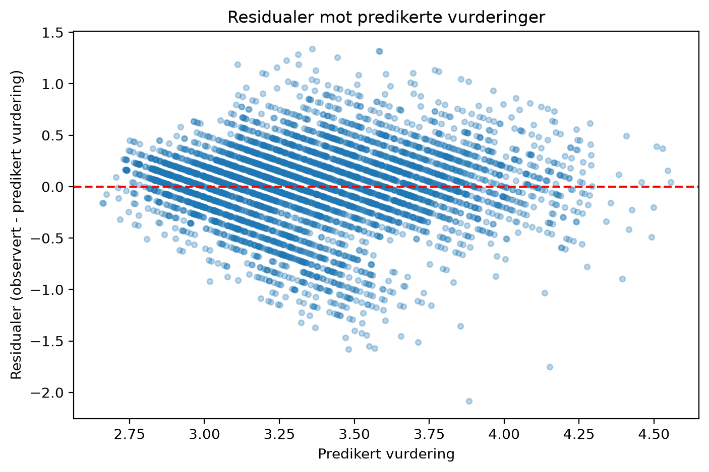
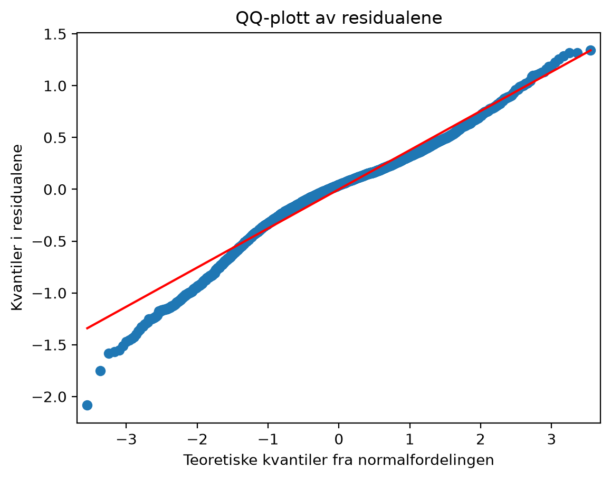

# Regresjon

## Metode

Vi brukte multippel lineær regresjon for å undersøke sammenhengen mellom pris og restaurantvurdering. Formålet var særlig å undersøke hypotese 1 (H1), som er om høyere pris henger sammen med høyere vurdering når vi samtidig kontrollerer for antall stemmer og tjenester. I en multippel lineær regresjon beskrives en numerisk respons ved hjelp av flere forklaringsvariabler. Hver regresjonskoeffisient beskriver den estimerte endringen i forventet respons når en forklaringsvariabel øker med en enhet, mens de øvrige forklaringsvariablene holdes faste. Modellen tilpasses med minste kvadraters metode, noe som minimerer summen av de kvadrerte forskjellene mellom observerte og predikerte verdier (Muff, 2026). 

Restaurantens gjennomsnittlige vurdering (rating) ble brukt som responsvariabel. Forklaringsvariablene var log-transformert pris (log_cost), log-transformert antall stemmer (log_votes), bordbestilling(table_booking), nettlevering (online_delivery) og by (city). Årsaken til at pris og antall stemmer ble brukt på en logaritmisk skala var for å dempe forskjellene mellom svært høye og lave verdier. Bordbestilling og nettlevering ble kodet som binære variabler, der 1 betyr at restauranten tilbyr tjenesten og 0 betyr at den ikke gjør det. By ble behandlet som en kategorisk variabel med Gurgaon som referansekategori. Koeffisientene for de øvrige bykategoriene beskriver dermed forskjellene fra Gurgaon når de andre forklaringsvariablene holdes faste. 

Modellen ble tilpasset med statsmodels i Python på gruppens felles treningssett,  inneholdt 5203 restauranter. Det separate testsettet ble brukt til å evaluere prediksjonene etter tilpasningen av modellen. 

Modellen forutsetter en lineær sammenheng mellom forventet vurdering og forklaringsvariablene på de valgte skalaene. Feilleddene antas å være uavhengige, ha forventning null og konstant varians. For de vanlige hypotesetestene og konfidensintervallene antas det også normalfordelte feilledd (Muff, 2026). Modelltilpasningen ble undersøkt med et residualplott, og normalitetsantakelsen ble vurdert med et QQ-plott. Koeffisientene ble rapportert med standardfeil, p-verdier og 95 % konfidensintervaller. Vi brukte et signifikansnivå på 5 %. 

Forklaringsgraden til modellen på treningssettet ble oppsummert med R² og justert R². Prediksjonene på testsettet ble evaluert med RMSE, som er kvadratroten av gjennomsnittlig kvadrert prediksjonsfeil. RMSE måles i vurderingspoeng, og jo lavere verdi, desto mindre prediksjonsfeil. Som sammenligningsgrunnlag brukte vi en gjennomsnittsmodell som predikerer gjennomsnittlig vurdering fra treningssettet for alle restauranter i testsettet. 

## Resultater

Modellen fikk R² = 0.435, og justert R² = 0.434. Denne forklarer dermed 43.5 % av variasjonen i restaurantvurderingene i treningssettet. De estimerte koeffisientene med standardfeil, p-verdier og 95 % konfidensintervaller er vist i tabell 1.

| Variabel | Koeffisient | Standardfeil | p-verdi | 95 % konfidensintervall |
| --- | ---: | ---: | ---: | ---|
| Konstantledd | 2.518 | 0.059 | < 0.001 | [2.402; 2.633] |
| New Delhi | -0.020 | 0.016 | 0.199 | [-0.051; 0.011] | 
| Noida | -0.120 | 0.022 | < 0.001 | [-0.163; -0.078] | 
| Other | 0.209 | 0.021 | < 0.001 | [0.167; 0.251] |
| Log-transformert pris | 0.011 | 0.010 | 0.262 | [-0.008; 0.030] |
| Log-tranformert antall stemmer | 0.198 | 0.004 | < 0.001 | [0.190; 0.206] |
| Bordbestilling | 0.009 | 0.018 | 0.604 | [-0.026; 0.044] | 
| Nettlevering | -0.071 | 0.012 | < 0.001 | [-0.094; -0.049] |

**Tabell 1. Resultater fra den multiple lineære regresjonsmodellen. Gurgaon er referansekategori for by.**

Koeffisienten for log-transformert pris var 0.011. Det vil si at én enhets økning i log-transformert pris var forbundet med en estimert økning på 0.011 vurderingspoeng når antall stemmer, bordbestilling, nettlevering og by ble holdt faste. Sammenhengen var imidlertid ikke statistisk signifikant ved et signifikansnivå på 5 % (p = 0.262). Konfidensintervallet på [-0.008; 0.030] inneholdt både negative og positive verdier, og vi fant derfor ikke statistisk støtte for H1 i denne modellen. 

Log-transformert antall stemmer hadde en positiv koeffisient på 0.198 (p < 0.001). Dermed var én enhets økning på denne skalaen forbundet med 0.198 poeng høyere forventet vurdering, når de øvrige forklaringsvariablene ble holdt faste. 
Restauranter med bordbestillinger hadde en estimert vurdering som var 0.009 poeng høyere enn de uten bordbestilling. Dette gjelder når de øvrige forklaringsvariablene holdes faste. Forskjellen var ikke statistisk signifikant (p = 0.604). 
Restaurantene som hadde nettlevering hadde en estimert vurdering som var 0.071 poeng lavere enn de uten nettlevering, når de øvrige forklaringsvariablene ble holdt faste. Her var forskjellen statistisk signifikant (p < 0.001), men liten målt i vurderingspoeng. 
Med Gurgaon som referansekategori kom det frem at restaurantene i New Delhi hadde en estimert vurdering som var 0.020 poeng lavere, men at forskjellen ikke var statistisk signifikant (p = 0.199). Restaurantene i Noida hadde en estimert vurdering som var 0.120 poeng lavere, og restaurantene i kategorien "Other" hadde en estimert vurdering som var 0.209 poeng høyere. Begge disse to forskjellene var statistisk signifikante (p < 0.001). Disse sammenligningene gjelder når pris, antall stemmer og tjenester holdes faste. 
Konstantleddet på 2.518 beskriver modellens forventede vurdering for en restaurant i Gurgaon når alle de øvrige forklaringsvariablene er null. Dette innebærer blant annet null på de log-transformerte skalaene og hverken bordbestilling eller nettlevering. En slik kombinasjon er ikke representativ for restaurantene i analysen, og konstantleddet har derfor begrenset praktisk tolkning. 

På testsettet fikk regresjonsmodellen en RMSE på 0.392 vurderingspoeng, mens gjennomsnittsmodellen fikk 0.513. Dette tilsvarer omtrent 24 % lavere RMSE for regresjonsmodellen. Dette viser at modellen predikerte vurderingene til restauranter i testsettet bedre enn å bruke gjennomsnittlig vurdering fra treningssettet for alle restaurantene. 

## Modellkontroll og begrensninger

Residualplottet (figur 1) viser skrå striper som oppstår fordi vurderingene er avrundet til én desimal. Restauranter med samme observerte vurdering følger linjen *residual = observert vurdering - predikert vurdering*. Stripene alene betyr derfor ikke at modellen passer dårlig, men spredningen ser imidlertid ut til å variere med predikert vurdering, slik at antakelsen om konstant varians er usikker. De enkelte, store negative residualene viser også at modellen overvurderer vurderingene til noen restauranter.

**Figur 1. Residualer mot predikerte vurderinger. Den røde linjen viser residualer = 0.**
 
I QQ-plottet (figur 2) følger punktene referanselinjen nokså godt rundt midten, men avviker tydelig i venstre hale. Dette tyder på at det er flere, eller mer ekstreme negative residualer enn ved en normalfordeling. Modellforutsetningene er dermed ikke fullt oppfylt, og p-verdiene og konfidensintervallene må tolkes med forsiktighet. Likevel ga modellen lavere prediksjonsfeil på testsettet enn gjennomsnittsmodellen. Fordi dataene er et øyeblikksbilde, kan analysen kun vise sammenhenger, og ikke fastslå årsaksforhold. 

**Figur 2. QQ-plott av residualene mot en normalfordeling.**
