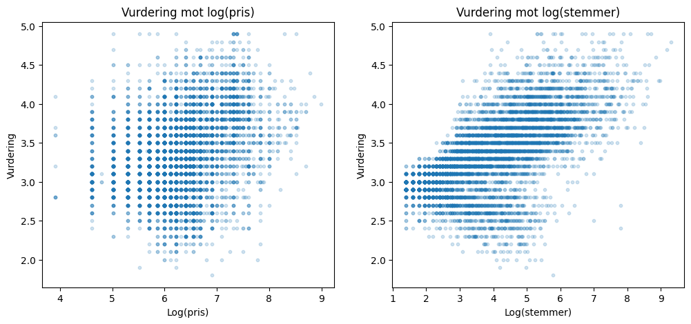

# Utforskende analyse

Spredningsplottene i figur x viser sammenhengen mellom vurdering og pris og mellom vurdering og antall stemmer. Her har vi brukt de naturlige logaritmene av pris og antall stemmer for å fjerne ekstremverdiene og dermed enklere kunne se mønstre i plottene.

**Figur x: Vurdering mot logaritmen av pris for to personer (venstre), og antall stemmer (høyre)**

|  | rating | high_rating | cost | log_cost | votes | log_votes | price_range | table_booking | online_delivery |
| --- | ---: | ---: | ---: | ---: | ---: | ---: | ---: | ---: | ---: |
| rating | 1.000000 | 0.808409 | 0.312530 | 0.321755 | 0.397342 | 0.623422 | 0.361476 | 0.174433 | 0.031343 |
| table_booking | 0.174433 | 0.180191 | 0.596040 | 0.584933 | 0.164084 | 0.293084 | 0.569961 | 1.000000 | 0.038433 |
| online_delivery | 0.031343 | 0.103783 | -0.025179 | 0.102678 | 0.054621 | 0.223966 | 0.037770 | 0.038433 | 1.000000 |

**Figur x : Korrelasjonstabell**

I spredningsplottet for pris er det stor spredning i vurderingene. Noe som gir mening med tanke på korrelasjonstabellen hvor pris og vurdering har en korrelasjon på omtrent 0,32. Samtidig er det en gradvis større konsentrasjon av høyere vurderinger når prisen øker over log(6).

I plottet for stemmer er det en mindre spredning i vurderingene. Slik som for pris gir dette mening med korrelasjonstabellen, hvor vi har en korrelasjon på omtrent 0,62. Vurderingene blir tydelig høyere når en restaurant har fått flere stemmer.

Bordbestilling og nettbestilling har i seg selv liten korrelasjon med vurdering, med nettbestilling på nær ingen korrelasjon på 0,03. Men bordbestilling har høy korrelasjon med pris på 0,58. Det vil si at bordbestilling kan være med på å påvirke vurderingen sammen med pris, ved at for eksempel bordbestilling kan føre til høyere pris.

For hypotese 1 er den positive korrelasjonen mellom vurdering og de ulike kategoriene i tråd med vår hypotese, men i ulik grad. For hypotese 2 er det positiv korrelasjon mellom de ulike kategoriene, som antyder at de sammen kan klassifisere en restaurant som høyt vurdert bedre enn hver for seg.
